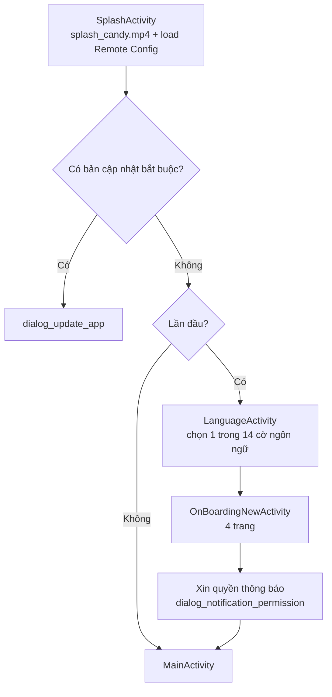
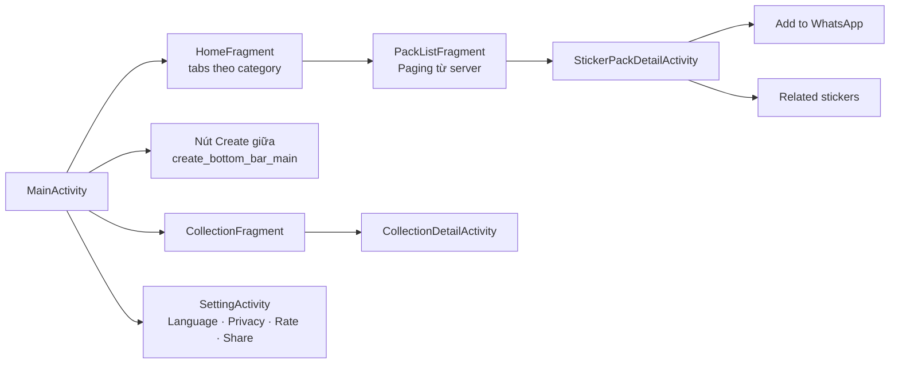
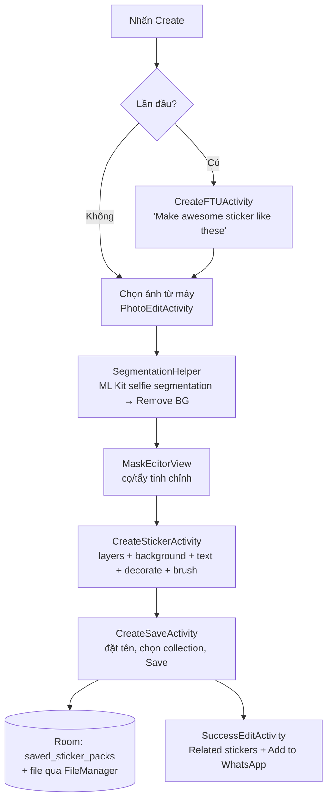
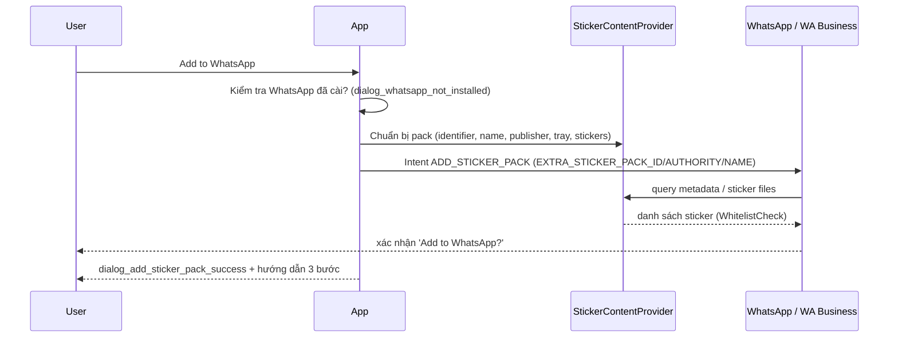
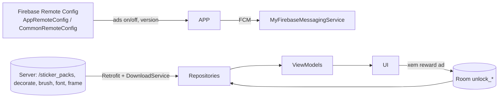

# 02 – Luồng hoạt động (user flow & data flow)

Suy luận từ manifest, tên Activity/Fragment/ViewModel, layout, chuỗi UI. Mức tin cậy: **trung bình** (chưa đọc mã decompile).

## 1. Khởi động lần đầu

Onboarding: 1) Make Unlimited Sticker Packs → 2) Smart Cutout Tools → 3) Fun Text & Decorations → 4) Easy Export & Share. Có native ad xen kẽ (`native_intro*`, `native_language*`).

## 2. Màn chính (MainActivity – bottom nav)

## 3. Luồng tạo sticker (core)

Công cụ trong editor: Layers (xem/ẩn/sắp xếp) · Background (màu/ảnh) · Text (font Kodchasan/Comfortaa/Gorditas, màu) · Brush (stroke 1–8, icon tim/sao/hoa/bướm) · Decorate sticker (nhóm tải từ server, có khoá reward) · Undo/Redo · Discard dialog.

## 4. Chỉnh sửa sticker có sẵn
`CollectionDetailActivity` → chọn sticker → `EditStickerActivity` (cùng bộ công cụ với Create) → Save → cập nhật Room.

## 5. Thêm vào WhatsApp

Hướng dẫn: ① mở WhatsApp, bấm icon sticker ② chọn pack đã xuất ③ chạm sticker để gửi.

## 6. Luồng dữ liệu & mở khoá

## 7. Luồng thoát / giữ chân
Back khi đang tạo → `are_you_sure_to_exit_the_app`/`dialog_discard_changes`. Gỡ app → `KeepUserActivity` ("Join Millions of Users…") → `SurveyUserActivity` (chọn lý do).

## 8. Điểm chưa xác định
- Cấu trúc JSON/endpoint server (base URL không thấy trong DEX; có thể từ Remote Config hoặc chuỗi mã hoá — có `assets/aes_*.dat`, có thể thuộc SDK).
- Thứ tự chính xác các màn bên trong `CreateStickerActivity` và quy tắc khoá reward.
Cần decompile (JADX) hoặc phân tích động để xác nhận.
